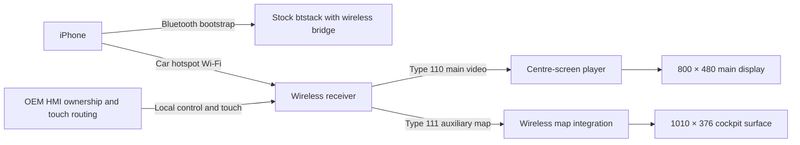

# MU1447 omonob native wireless CarPlay implementation review

Reviewed on 23 November 2026 for the SEAT and Cupra Ateca installation.

**Current result:** the owner reports that the car is now working perfectly, with no bugs currently observed. That is the latest vehicle report and supersedes the earlier reports of disconnects, camera return problems, touch failures and startup lag. The successful configuration previously reported keeps the car's WLAN hotspot enabled and its Wi-Fi internet client and automatic network search disabled.

Getting to this result required changes across the MU1447 integration, Bluetooth bootstrap, networking, display descriptors, touchscreen routing, camera ownership, startup and installation. Several earlier problems came from our adaptation or from how retained upstream components interacted; they were not all Wi-Fi problems, and they were not all defects in omonob's original implementation.

The result applies to this vehicle and installed configuration. It is not a claim that every phone, firmware, radio environment or vehicle has received the same acceptance testing.

## Target and starting point

The current implementation targets **MHI2_ER_SEG11_P4709, MU1447, with a 790-family cockpit**. The centre screen is 800 × 480 pixels; the auxiliary cockpit surface is 1010 × 376 pixels.

The starting point was a working omonob public wired CarPlay Maps installation, v2.1.0-rc.7 for MU1447/790. Wired cockpit maps were already functional. We added the requested display changes and then integrated the supplied omonob wireless receiver, Bluetooth bridge, video player and Java service approach.

This is the implementation published in the separate [`omonob-mu1447` branch](https://github.com/RandomGenerated543/seat-cupra-mu1409-carplay/tree/omonob-mu1447). The older MU1409 implementation and the custom wireless USB-adapter firmware are separate projects. They helped establish useful diagnostic patterns, but their patches are not interchangeable with the current MU1447 installation.

The reviewed publication snapshot is commit [`f6c4bf84f0d3a33ce8cf2e6d7a4c3d06b3f23436`](https://github.com/RandomGenerated543/seat-cupra-mu1409-carplay/commit/f6c4bf84f0d3a33ce8cf2e6d7a4c3d06b3f23436). Its source and eight original SD archives are preserved together.

## How the working system fits together

Bluetooth performs discovery and wireless CarPlay bootstrap. The phone then uses the car's own Wi-Fi hotspot for the CarPlay session. The native receiver accepts the session and its streams. The centre-screen video player renders the main display, while the existing wireless map integration carries the auxiliary map to the cockpit.

The OEM user interface still has to coordinate CarPlay with its own screens, camera overlays, audio resources and touch input. Receiving video is therefore only part of the implementation. The HMI must know which session is active and who owns the display and touchscreen at each moment.

The Bluetooth hook belongs in the Bluetooth process. The receiver and video player run separately. The integration deliberately clears the Bluetooth preload environment before launching those other programs; loading a Bluetooth-specific interposer into the receiver or player would be incorrect and could crash them.

## Adapting the integration to the exact MU1447 firmware

### Native compatibility checks

We extracted and checked the actual MU1447 firmware inputs rather than assuming that another MU's package would work because the product name looked similar. The installer pins the identities of `lsd.jxe`, `btstack`, `connectionmanager` and stock `libairplay.so`.

Those four OEM binaries are **checked, not replaced** by the wireless installer. The supplied Bluetooth bridge was audited against 15 entry-point fingerprints in the exact MU1447 Bluetooth executable. That established that the expected native entry points matched; actual Bluetooth pairing and session behaviour still had to be demonstrated on the car.

We added a small compatibility library, `libmu1447-bt-normalize.so`. QNX permits thread ID zero to refer to the calling thread. The shim changes that zero to `pthread_self()` before forwarding `pthread_setname_np`, so the bridge's thread bookkeeping receives the real thread identity. It is a narrow compatibility correction, not a replacement Bluetooth stack.

Sources: [native binding audit and normalizer](https://github.com/RandomGenerated543/seat-cupra-mu1409-carplay/tree/omonob-mu1447/omonob-mu1447/src/wireless-base/native).

### Using the actual MU1447 touch class

The touch adaptation uses MU1447's own `TouchInputDeviceImpl`, preserving its OEM methods. We inserted one forwarding decision at the exact `updateTouchInput(IIIIIII)V` entry. If the wireless touch handler accepts an event, it consumes it; otherwise the original OEM input path continues.

This matters because replacing an input class from another firmware can lose methods, change the expected interface or interfere with unrelated vehicle screens. Merely getting a class to load would not prove that those behaviours were preserved.

### Starting the required Java services

The wireless bootstrap was patched to start the phone-integration and CarPlay integration services explicitly. Retaining the classes in an archive was insufficient if nothing started them on this firmware's boot path.

The existing public wired menu was preserved entry by entry. Fifteen missing phone-integration helper classes were added from the supplied integration instead of replacing the complete menu with a different donor version. HMI launch and bundle configuration were merged to load the required wireless components.

The Java runtime on this platform also constrained the build. Helper classes were normalized to class-file version 46; incompatible newer bytecode was rejected, and generated `StringBuilder` references were adjusted to the older supported `StringBuffer` API. Metadata/link checks were performed against the exact MU1447 classes, with additional checks on the unit's own J9 runtime. These checks load class metadata without running the activators during preflight.

Sources: [MU1447 touch and bootstrap patchers](https://github.com/RandomGenerated543/seat-cupra-mu1409-carplay/tree/omonob-mu1447/omonob-mu1447/src/wireless-base), [runtime normalization and linkage](https://github.com/RandomGenerated543/seat-cupra-mu1409-carplay/tree/omonob-mu1447/omonob-mu1447/src/wireless-runtime).

## Bluetooth startup and persistent operation

The persistent integration changes the configured Bluetooth launch command to a wrapper. That wrapper conditionally loads the wireless bridge and compatibility shim, then executes the original Bluetooth executable. Enable/off flags control the added behaviour.

The wrapper starts the wireless autostart helper detached, so receiver preparation does not block Bluetooth startup. Persistent programs and scripts live under `/mnt/ota` and `/mnt/app/carplaymaps`; the required runtime files are staged individually into `/dev/shmem` after boot. Successful installation therefore survives a normal restart and does not require leaving the SD card inserted.

The receiver and player receive explicit dimensions for the 800 × 480 centre screen. This is separate from the cockpit geometry. The physical main-display dimensions are also set in the startup environment, and touch coordinate scaling is tied to that main display. Treating the centre screen as a larger donor display would make touch coordinates and rendered content disagree.

The startup waits for the hotspot interface to be running and addressed. It does not wait for an already-associated phone before starting the receiver: the receiver must be listening before the phone attempts its connection. The inherited hotspot assistance uses the OEM HMI request path when needed, rather than directly reprogramming the WLAN driver.

The supplied pairing mechanism and persistent pairing data are retained. We did not create new MFi certificates or make a new authentication stack. A stuck historical phone association could require forgetting the phone-side CarPlay/Bluetooth association and pairing again; the later Runtime and Startup corrections themselves do not require resetting pairing.

Sources: [Bluetooth wrapper and channel watcher](https://github.com/RandomGenerated543/seat-cupra-mu1409-carplay/tree/omonob-mu1447/omonob-mu1447/src/wireless-base/ota), [corrected autostart and controller](https://github.com/RandomGenerated543/seat-cupra-mu1409-carplay/tree/omonob-mu1447/omonob-mu1447/src/wireless-runtime/scripts).

## Networking and the disconnect investigation

### Opening the required hotspot traffic

The factory hotspot firewall has a general inbound block. Wireless CarPlay needs explicit traffic allowances before that rule. We retained the runtime policy-generation approach: copy the currently appropriate OEM firewall policy, insert the CarPlay rules, ask native `pfctl` to parse the candidate, and only then load it.

The traffic groups in the current network correction are:

| Traffic | Ports | Existing OEM queue pair |
|---|---|---|
| TCP control and events | 5000, 5001 | `control_out`, `control_ack` |
| TCP main and auxiliary video | 6030, 6031 | `video_out`, `video_ack` |
| UDP control and time synchronization | 5020, 6020 | `control_out`, `control_ack` |
| UDP audio and related control | 6000, 6003, 6004, 6011 | `audio_out`, `audio_ack` |

Outgoing time-sync traffic using UDP source port 6020 receives control-queue classification too. The additional allowances are scoped to the hotspot interface/network. The correction reuses existing factory queue definitions and refuses a policy missing the expected queues.

The first scripts permitted the ports but omitted this explicit factory queue classification. That omission was corrected so control, audio and video use their intended queue groups. It was relevant to the observed timeouts, ENOBUFS errors and poor behaviour when SSH and CarPlay competed, but it did not by itself prove the cause of every disconnect.

### Preserving the correct OEM NAT policy

The car has different firewall variants for different internet uplinks. Loading the wrong base file can remove the NAT configuration belonging to the current uplink. The integration therefore detects the active OEM NAT arrangement and selects the corresponding `pf.conf`, `pf.mlan0.conf`, `pf.ppp0.conf` or `pf.ecm0.conf` source.

Every original line of the selected policy is preserved. The persistent OEM `/etc/pf*.conf` files are not rewritten; the added policy is generated at runtime. This also preserves existing SSH and other factory rules rather than replacing the firewall with a minimal CarPlay-only configuration.

### Restoring rules after OEM reloads

The connection manager can reload the factory firewall when WLAN state changes. That can remove the added CarPlay allowances even though the receiver is still running. The firewall watcher checks for the added rules and reapplies them when absent.

The network correction changed its detection to use the stable label `MU1447_WCP_QOS_v1`, rather than depending on how `pfctl` happens to print a dynamic interface address. The watcher checks every three seconds. Reloading does not deliberately flush every firewall state.

### Advertising the real hotspot channel

The hotspot interface `uap0` and internet-client interface `mlan0` share a radio. When the client joins a home network, the hotspot can move to that network's channel. The configuration file read by the Bluetooth bootstrap can temporarily retain the previous channel.

The channel watcher reconciles that file with the channel actually reported by the interface. It publishes a readiness marker after the channel settles, removes readiness when it observes a later change, and allows the existing reconnect procedure to wait for that readiness within its bounds.

Our adaptation extended this watcher beyond its former roughly four-minute lifetime and added single-instance handling. A successful first connection should not mean that channel observation stops for the remainder of the journey.

**The watcher does not command the radio to move from channel 11 to channel 9.** It records the move that the OEM Wi-Fi system has made. It does not force a WLAN mode, replace a driver or change hotspot credentials.

### The vehicle setting that completed the successful setup

The vehicle logs showed whole-session errors, including `ECONNRESET`, timeout/connection errors and, in some captures, ENOBUFS sends. The receiver could remain alive across a disconnect. Later observations showed the hotspot changing from channel 11 to 9 while the car joined its Wi-Fi uplink, with the OEM firewall selection changing as well.

Those observations supported an interaction involving uplink association, hotspot/channel changes, policy reloads or shared-radio contention. They did not isolate a single exclusive cause. ENOBUFS alone did not prove a permanent global memory leak; a quiet mbuf snapshot taken after disconnect was not enough to reconstruct earlier conditions either.

The owner then disabled the car's internet-client connection and automatic network search while keeping its hotspot enabled. They reported that disconnects stopped and operation became more fluid. On 23 November they confirmed that the car was working perfectly with no bugs currently observed.

This manual Wi-Fi setting is part of the successful configuration. The packages do not silently disable the user's internet-client function. Reliable simultaneous home-Wi-Fi uplink and CarPlay operation is not established by the current result.

Sources: [network scripts, installer and tests](https://github.com/RandomGenerated543/seat-cupra-mu1409-carplay/tree/omonob-mu1447/omonob-mu1447/src/wireless-network), [earlier vehicle report](https://github.com/RandomGenerated543/seat-cupra-mu1409-carplay/blob/omonob-mu1447/omonob-mu1447/validation/OPERATOR-REPORT-2026-11-21.json).

## Parking cameras and display ownership

The camera problem was a control-state problem, not simply a missing video frame. An OEM camera screen can temporarily borrow the display while an underlying CarPlay canvas still exists. The presence of that canvas must not give CarPlay permission to take touch or reclaim the display over the camera controls.

An early custom ownership patch used one state too broadly. In the sequence “camera borrows screen → observer says CarPlay was left → camera releases screen,” the observer could latch an additional taken state. Releasing the borrow then failed to clear the overall block. CarPlay could remain suppressed until another entry event or restart.

The final ownership helper separates explicit take/borrow state from observed canvas suppression. It also tracks a pending UI request, current foreground readiness and state/session revisions. A notification that the canvas was hidden no longer has the same meaning as an explicit ownership transfer.

The guards were extended to other screen-claim paths too. It was insufficient to protect only canvas synchronization and touch routing while another function could still send “CarPlay owns the screen.” Outgoing ownership confirmations and automatic foreground entry are deferred while an OEM screen owns the display, then reconciled when ownership is released.

There is also a display-context integration detail: when the HMI's stage-three CarPlay canvas owns context switching, the video player must not independently force its older custom context over it. The startup selects the appropriate player context mode instead of making the HMI and player compete over the display.

These changes address the mixed sequences behind camera controls receiving no touch, black/stuck returns, and apparently dead CarPlay after leaving an OEM screen. They do not imply that every black screen in every earlier build had this same cause.

Sources: [current screen-ownership helper](https://github.com/RandomGenerated543/seat-cupra-mu1409-carplay/blob/omonob-mu1447/omonob-mu1447/src/wireless-startup/java/de/vw/mib/asl/internal/wcpcp/Mu1447ScreenOwnership.java), [runtime bytecode patcher](https://github.com/RandomGenerated543/seat-cupra-mu1409-carplay/blob/omonob-mu1447/omonob-mu1447/src/wireless-startup/PatchRuntime.java).

## Touchscreen routing and apparent freezes

The early forwarding path called the touch sender synchronously from the OEM input callback. A delayed UDP send or logging operation could hold up that callback. An injected socket stall demonstrated the risk locally; that did not prove that every reported on-road freeze was a blocked touch send.

The corrected handler places accepted events into a bounded 64-entry queue and returns to the OEM input path. A separate worker performs the local UDP transmission to the receiver on port 7102. Movement events can coalesce, space is reserved for gesture completion, and a supervised stalled sender can have its socket closed without putting network I/O back into the input callback.

Routing also respects gesture boundaries. A gesture begun in CarPlay must not turn into a partial gesture on the camera controls halfway through a press. Likewise, an OEM gesture must not suddenly become a CarPlay gesture. Ownership revisions and session revisions invalidate stale queued movement. Release handling accounts for a press already delivered to the same session.

Touch is allowed only when the wireless session/service and foreground state are ready and the ownership information is fresh. If CarPlay should not receive the event, the original OEM handler remains available. The touch-disable flag is refreshed by the manager rather than depending on a one-time initialization path that the earlier adaptation could miss.

Source: [current asynchronous touch handler](https://github.com/RandomGenerated543/seat-cupra-mu1409-carplay/blob/omonob-mu1447/omonob-mu1447/src/wireless-startup/java/de/vw/mib/asl/internal/system/input/CpWcpTouch.java).

## Startup reliability and the remaining initial delay

### Recovering from services that are not ready yet

The previous lifecycle could set `started=true` before resolving its dependencies. If initialization then failed temporarily, a later start request could see that flag and do nothing. That fitted the reported symptom of touch/integration being absent on one boot and returning after a restart.

We introduced a restartable lifecycle with bounded readiness retries and cleanup. It retries service resolution and observer/listener setup instead of treating a temporary boot ordering problem as permanent. Cleanup clears the started state so a failed initialization is not latched forever.

### Avoiding duplicate registrations

Retries create their own risks unless partial registration is handled carefully. The correction retains the identity of registered listeners and event targets until cleanup actually succeeds. It checks target ownership before reusing or unregistering it, reconciles partial observer/listener registration, and avoids creating duplicate targets or workers during retries.

### Waking the worker after a screen event

After Runtime v0.1, the owner reported approximately one to two seconds of initial touch delay, with normal response after startup. A further test reproduced an approximately one-second readiness wait in the CP worker: a screen-entry event could arrive while the worker still had cached “not ready” state and was about to sleep.

Startup v0.1 signals that existing worker after relevant screen/service events. A revision counter prevents losing the notification between sampling state and entering the wait. The original one-second idle wait remains; we did not solve this by increasing polling frequency.

The host comparison measured approximately 1005 ms before the correction and 1 ms after it for readiness wake-up. This is a host measurement of that wait, not a claim of one-millisecond touch-to-picture latency in the car.

Sources: [current lifecycle helper](https://github.com/RandomGenerated543/seat-cupra-mu1409-carplay/blob/omonob-mu1447/omonob-mu1447/src/wireless-startup/java/de/vw/mib/asl/internal/wcpcp/Mu1447Lifecycle.java), [startup test record](https://github.com/RandomGenerated543/seat-cupra-mu1409-carplay/blob/omonob-mu1447/omonob-mu1447/validation/startup-local-tests.json).

## Receiver startup and session lifetime

### One verified startup owner

The retained autostart flow could have two helpers both pass an absent-PID check and attempt to stage/start receiver and video processes. A separate failure was accepting any live PID from a stale PID file as proof that the receiver was running.

The native runtime guard now serializes startup/staging with a process lock. It verifies the receiver's process identity and expected code fingerprints before accepting it as running. An ambiguous observation is refused rather than launching a competing receiver. Start/stop management uses identified processes rather than a broad kill-by-name operation.

### Separating the phone session from its main video stream

The previous session freshness check relied on marker files maintained by the main video player. Closing or reopening that local video stream could therefore look like the whole phone session had ended. The Java integration could unregister its CarPlay service or release cockpit acceptance even when the receiver's phone session still existed.

The added session observer opens receiver process memory read-only, verifies the known callback fingerprints and reads its existing session pointer. It publishes a small status record under `/ramdisk`, with receiver and monitor identities, a generation, a sample counter and active/idle/unknown state. Publication uses a completed temporary file and rename.

Java consumes that observation with freshness limits and session-generation handling. A main-screen video interruption can then be distinguished from an actual phone session ending. A genuine receiver-session change still invalidates the old session and its stale touch state.

The observer recognizes the three delivered receiver variants: the base receiver and the two supported layout variants. It does not write receiver memory or alter pairing material. Its compatibility inspection was also exercised on the car during Runtime preflight.

Sources: [native runtime guard](https://github.com/RandomGenerated543/seat-cupra-mu1409-carplay/blob/omonob-mu1447/omonob-mu1447/src/wireless-runtime/native/runtime_guard.c), [session-health helper](https://github.com/RandomGenerated543/seat-cupra-mu1409-carplay/blob/omonob-mu1447/omonob-mu1447/src/wireless-startup/java/de/vw/mib/asl/internal/wcpcp/Mu1447SessionHealth.java).

## Cockpit maps and display adjustments

### Main and auxiliary displays remain separate

The receiver handles a Type 110 main display and Type 111 auxiliary cockpit map. The main surface is 800 × 480, while the cockpit surface is 1010 × 376. The existing wireless map integration and transport remain responsible for getting the auxiliary map to the cockpit.

Both displays request 30 fps. The auxiliary request was corrected from the donor's 60-fps ceiling to 30. These are requested limits, not guaranteed measured rates. There is no qualified 60-fps mode in this build.

### Fixed cockpit scaling

The requested cockpit `zoomFactor` is fixed at 70. For wired use, a dedicated wrapper adjusts only Type 111 entries in the AirPlay server information. For wireless use, a pinned receiver descriptor hook sets the auxiliary value during construction. No additional custom zoom menu was added.

This is layout scaling requested from the phone. It is separate from steering-wheel buttons that change a navigation app's geographic zoom, and it is separate from the older MU1409 main-screen icon-scaling experiment.

### Correcting the actual navigation-card mapping

The first adjustment incorrectly treated views 0 and 4 as a custom “Wide” mode. Tracing the actual omonob menu and executing its native selector showed that those views belonged to Off/non-navigation behaviour. Center was view 3.

The corrected wired layout restored that mapping, and the wireless layout correction made wireless follow it. Final safe rectangles are listed as **x, y, width, height**, in source cockpit pixels:

| Native card choice | Native view behaviour | Final safe rectangle | Request |
|---|---|---|---|
| Off | View 0 idle, view 4 navigating | 202, 1, 606, 329 | ETA on, maneuver card off |
| Left | View 0 idle, view 1 navigating | 202, 45, 606, 252 for view 1 | Left-aligned maneuver card, ETA on |
| Right | View 0 idle, view 2 navigating | 202, 45, 606, 272 for view 2 | Right-aligned maneuver card, ETA on |
| Center | View 3 with or without a route | 191, 76, 628, 185 | Top-aligned maneuver card, ETA on |

Center was first placed at Y=56 and then lowered to Y=76 after the owner reported that it disappeared too far above the visible area. Left's lower boundary was raised by 20 pixels by reducing its height from 272 to 252; its top edge stayed at Y=45. Off was restored to its larger original rectangle rather than inheriting the Center modification.

### Making wireless honour the saved card choice

The owner supplied a saved preference with `position=0`. In that preference format, zero means Center; it does not mean native view zero. Wireless had been starting unconditionally with view zero, so it could start with the wrong layout despite the correct saved selection.

The wireless correction reads the existing preference through the project's canonical CRC/generation-checked reader. Center starts with view 3; the initial URL matches the chosen card mode. It identifies the installed wired core and uses the corresponding supported rectangle table, including the final Center-down variant.

A dedicated, closed/flushed status file records the selected position, initial view and zoom result, avoiding dependence on buffered startup log output. The receiver integrity guard's expected hash was updated for the exact modified receiver; integrity comparisons were retained.

### Requesting ETA and maneuver alignment

All four scenes request `showETA=yes` while retaining their appropriate maneuver choice. Off uses the dedicated `/map` URL with `maneuverLayout=no`; Center uses `topAligned`; Left and Right use their respective alignments.

The Left URL omits the optional `showSpeedLimit=no` parameter because the longer ETA request had to fit its fixed native string slot without moving code or pointers. Left therefore uses the phone app's default speed-limit preference. That is a specific compatibility tradeoff, not a lost ETA request.

Safe areas are layout hints to the navigation app, not direct pixel offsets for every item. The phone/app ultimately decides what content it renders inside them.

Sources: [wired display sources](https://github.com/RandomGenerated543/seat-cupra-mu1409-carplay/tree/omonob-mu1447/omonob-mu1447/src/wired-display), [wired mapping corrections](https://github.com/RandomGenerated543/seat-cupra-mu1409-carplay/tree/omonob-mu1447/omonob-mu1447/src/wired-layout), [wireless preference and descriptor correction](https://github.com/RandomGenerated543/seat-cupra-mu1409-carplay/tree/omonob-mu1447/omonob-mu1447/src/wireless-layout).

## Exactly what was patched and what was carried forward

| Component | Treatment |
|---|---|
| Stock `btstack`, `connectionmanager`, `libairplay.so`, `lsd.jxe` | Exact identity checks; no replacement by the wireless installer |
| Supplied `libbtwcp.so` | Carried forward unchanged; normalizer added separately |
| `wcp_receiver` | Exact auxiliary zoom, safe-area and frame-rate edits; later preference/initial-URL hook |
| `libomonob-wireless-maps.so` | Navigation URL edits for ETA/card behaviour |
| `wireless-receiver-exec` | Expected receiver/map-helper digests updated; integrity checking retained |
| Centre-screen player and supplied transport/video helpers | Existing donor functionality retained by these corrections |
| Java CP, touch and bootstrap archives | MU1447 integration, ownership, lifecycle, asynchronous touch and readiness fixes |
| `VCMenu.jar` | Original public menu entries retained; missing phone helpers added |
| Native runtime guard | Added for verified startup ownership and read-only session observation |
| HMI launch/bundle configuration | Merged to load the wireless integration |
| `connectivity.json` | Bluetooth execution redirected through the wrapper |
| Firewall/channel/autostart/controller scripts | Runtime rules, queue classification, channel observation and corrected startup management |
| Wired display core/add-on | Separate display/URL/geometry changes used as the matching layout baseline |

The published base binary-delta specification records 20 pinned receiver edits, eight map-helper edits and eight integrity-launcher edits. Those counts belong to the base patch specification; later layout work is a separate delta. Reproduction refuses an unexpected donor hash and verifies the complete output hash.

The existing omonob media/artwork launch path is preserved. The earlier MU1409 media translation bridge and main-screen zoom experiment were not transplanted into this branch. Wireless media/artwork did not receive a separate component acceptance record, so the owner's current overall success report should not be rewritten as a claim that each metadata/artwork case was individually measured.

## Installer corrections and recovery

The initial packaging failures were real installer defects, separate from wireless protocol behaviour.

| Revision | Problem corrected |
|---|---|
| Original rc1 | Demanded 30 MB free on a RAM disk whose total size was approximately 20 MB |
| rc1.1 | Calculated actual staging needs plus an 8 MiB reserve, but still hit a signed-size comparison problem on the much larger OTA volume |
| rc1.2 | Used decimal-aware comparison to handle more than 2 GiB free correctly; then exposed the backup manifest separator mismatch |
| rc1.3 | Wrote the native verifier's required two-space checksum separator and provided verified preservation/recovery of the unfinished rc1.2 backup |

The reported 3,123,281,920 bytes free on `/mnt/ota` was enough space; the earlier refusal was not a storage shortage. A `baseline_seal` failure occurred before runtime replacement. Recovery verifies all 41 saved baseline rows against the live files and preserves the old unfinished backup under a new name before retrying. It does not delete the only rollback data or bypass verification.

The runtime payloads remained identical across these installer-only base revisions. Calling them successive wireless-engine fixes would misdescribe the changes.

Other target constraints also shaped the installation: `/dev/shmem` does not support ordinary directory workflows, recursive copying into the small RAM disk had failed, and commands such as `dirname` or `rmdir` were not reliably available. The current packages run from SD, stage selected executable files into suitable temporary locations and use included native helpers.

Each installer checks supported before/after identities, saves and seals a backup, verifies staged/read-back files, supports recognized repeated application, and attempts rollback after a detected replacement failure. Unknown later edits are refused. These are guarded file transactions; sudden loss of power is not an atomic operation across all files.

The patches load after a normal manual infotainment restart. The installers do not automatically reboot the unit, factory-reset pairing or install/change SSH credentials.

Sources: [base installer and transaction tests](https://github.com/RandomGenerated543/seat-cupra-mu1409-carplay/tree/omonob-mu1447/omonob-mu1447/src/wireless-base), [installation guide](https://github.com/RandomGenerated543/seat-cupra-mu1409-carplay/blob/omonob-mu1447/omonob-mu1447/docs/INSTALL.md), [recovery guide](https://github.com/RandomGenerated543/seat-cupra-mu1409-carplay/blob/omonob-mu1447/omonob-mu1447/docs/RECOVERY.md).

## Why the publication contains eight SD packages

They represent the delivered dependency and backup history. They are not eight competing wireless implementations, and installing from stock still requires the supported wired base first.

| Order | Delivered package | Role |
|---|---|---|
| 1 | Wired Display v0.1.1 | Fixed 70% cockpit scaling and initial ETA/display support |
| 2 | Wired Layout v0.2 | Actual Off/Left/Right/Center mapping and corrected URLs/rectangles |
| 3 | Center Down v0.1 | Final Center Y=76 correction |
| 4 | Native Wireless v1.0-rc1.3 | Persistent MU1447 wireless integration |
| 5 | Wireless Network v0.1 | Existing OEM queue classification and stable rule-label detection |
| 6 | Wireless Layout v0.1 | Saved card selection and matching wired/wireless geometry |
| 7 | Wireless Runtime v0.1 | Camera, touch, lifecycle, startup locking and real-session observation |
| 8 | Wireless Startup v0.1 | Event-driven readiness wake in the CP archive |

Runtime v0.1 changes three Java archives, two scripts and adds the native guard. Startup v0.1 then replaces only the CP archive. The latter source includes the preceding runtime changes, but its installer still depends on Runtime v0.1 being installed.

Restore order follows those dependencies in reverse. Startup must be restored before Runtime; the later wireless corrections must be restored before the base wireless installer can verify and restore its original files. Keeping the separate original archives preserves their exact hashes and backups rather than inventing an untested combined installer after the car began working.

## Verification and the latest vehicle result

Local tests exercised the actual patched Java control flow with simulated OEM/network boundaries, including mixed camera event ordering, deferred screen claims, delayed services, partial registration failures, blocked touch sends, gesture handoff and session/video separation. Native tests covered process identity, exclusive locks and status publication. Installer fixtures covered supported variants, refusal, repeated application, exact restore, interrupted/mixed states and injected late-write failures.

ARM instruction tests exercised receiver hooks, register/return preservation, allocation failures, rectangle tables, preference/URL cases and integrity edits. Metadata tests checked the old Java ABI and preservation of unrelated methods/archive entries. Host tests did not emulate the complete vehicle, Wi-Fi radio, GPU or QNX scheduler; the on-unit checks and actual vehicle behaviour provide different evidence.

The original package receipts retain their build-time `UNTESTED` or `PENDING` hardware fields. Later vehicle reports supplement those records rather than changing the historical files. The earlier 21 November report recorded the uplink-off improvement; the **23 November owner report is now that the car works perfectly, with no bugs currently observed**.

On 23 November, publication verification also passed for all eight exact archives, their internal manifests, source/document links and excluded private-file categories. No vehicle was contacted for this review.

The earlier source audit also identified two defensive network edge cases that the Runtime/Startup corrections did not rewrite: the firewall watcher's handling of a failed rules query, and channel-readiness invalidation when a later interface query returns no channel. These are source-level limits, not new failures reported on the owner's now-working car. They are reasons to avoid claiming that every possible error condition or concurrent uplink scenario has been exhaustively eliminated.

The code and validation are published under [`omonob-mu1447/`](https://github.com/RandomGenerated543/seat-cupra-mu1409-carplay/tree/omonob-mu1447/omonob-mu1447). It contains our adaptation/patch sources, tests and exact delivered installers. Full OEM firmware source, the QNX SDK, private authentication material and complete source for opaque donor receiver dependencies are external inputs. Some builders require the exact retained donor files and adjusted local paths; this is not a standalone one-command reconstruction of every binary.

Upstream foundations: [omonob wired CarPlay Maps](https://github.com/omonob/VW-MHI2-Carplay-Maps) and [omonob native wireless CarPlay Maps](https://github.com/omonob/VW-MHI2-Wireless-Carplay-Maps). Their contribution, the supplied integration materials and existing community credits remain distinct from the MU1447 fixes described here.
